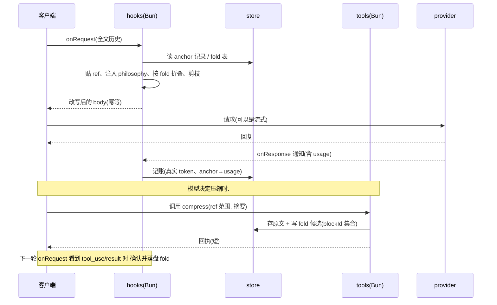

# magpie ACP 压缩插件:实现方案

目标:在 magpie 网关里复现 billion-context(ACP)的核心效果——**模型自己写摘要、历史被增量折叠、折叠可逆、提示前缀尽量不变**——但不复刻它「代理内部执行工具 + 往流里注入 tool_result」的手法,因为那三处接缝在 magpie 不存在(见 `magpie-middleware-feasibility.md` §3)。

形状:**一个 hooks 插件(Bun,持有状态与 I/O)+ 一个 tools 插件(Bun,提供 compress/decompress/search)+ 一份共享磁盘 store**。中间件只在一个可选场景出现(流内标记清洗)。

---

## 1. 非目标

- 不实现 tier1→2→3 的再压缩蒸馏(M2 之后单独评估;需要跨请求计数与再折叠策略)。
- 不自带外部摘要模型(外部摘要通道留空位,默认关闭)。
- 不改写客户端自己的会话文件,不改 magpie 的 provider 配置。
- 不做多用户/远端凭据映射。

---

## 2. 组件

| 组件 | 运行时 | 职责 | 为什么在这里 |
|---|---|---|---|
| `hooks.mjs` | Bun(async hooks) | 解析四协议 body、贴 ref、注入 philosophy 与 nudge、按 transcript 结算折叠、渲染折叠块 | 需要 `fs`(读 store)与跨请求内存;且必须能改 body |
| `tools.mjs` | Bun(tools 插件) | MCP 工具 `compress` / `decompress` / `search_context` / `acp_status` | 工具由**客户端**声明并执行;只有这里能返回工具结果 |
| `store`(磁盘) | — | 折叠原文、块索引、anchor 记录、用量记账 | 两个 Bun 宿主是不同进程,磁盘是唯一共享介质 |
| `middleware`(可选) | moejs | 只在流式回复里清洗 `📦 [ACP]` 标记 | hooks 拿不到流事件,只有 `onResponse` 通知 |
| `cli.mjs` | Node 22+ | `status` / `inspect` / `forget` / `unlock` / `reconcile` | 运维与对账,不参与请求路径 |

一个包还是两个包:`package.json` 里能否同时声明 `magpie.hooks` 与 tools 入口 **未验证**。方案按「一个包、两个入口文件」写;若宿主拒绝,拆成两个包共享 `store.dir`。

---

## 3. 数据模型

四个 id,各司其职:

| 名字 | 定义 | 稳定性 | 用途 |
|---|---|---|---|
| `blockId` | `sha256(规范化内容)[0:16]` | **内容寻址,永远稳定** | 折叠记录、原文存储、去重的唯一键 |
| `ref` | 渲染用的显示编号 `m00007` | 每段历史重算 | 模型在 `compress` 参数里引用的东西 |
| `anchor` | `sha256(anchor_prev + NUL + item)` 逐条消息累加的链 | 前缀不变则稳定 | 判断「这份 state 还属于当前历史吗」 |
| `sessionKey` | `sha256(protocol + cwd + session/agent 标签)` | 会话级 | store 分桶 |

**为什么 ref 只是显示编号**:bili 用 session ledger 让 ref 单调递增;我们没有可以信赖的 ledger(客户端会 compaction、编辑、分叉)。所以折叠记录只认 `blockId`,ref 在每次请求时按当前历史重新编号并写进 anchor 记录。compaction 之后 ref 会重排,但**折叠关系不丢**——因为它是内容寻址的。

`compress` 的参数里模型写的是 ref(它只看得见 ref)。解析顺序:本次请求的 `anchor 记录` 给出 `ref → blockId`,再查 `blockId → fold`。所以 fold 必须在**出现 compress 调用的那一轮**就按当轮的编号结算并存盘,不能等到下一轮(那时那几条消息可能已经被剪掉了)。

---

## 4. 一轮的时线



关键点:**摘要文本活在 transcript 里**(tool_result),所以 hooks 不依赖 tools 插件的在线状态;store 只保存「被折叠掉的原文」和「fold 的结算记录」。

---

## 5. 四个协议

| 协议 | 历史位置 | 注入点 | 折叠的坑 |
|---|---|---|---|
| `anthropic` | `messages[]`,content 是 block 数组;`system` 单列 | 最后一条 user 的 `content` 追加一个 `text` block | `tool_use`/`tool_result` 必须成对,折叠范围要整对吞掉 |
| `chat` | `messages[]`,assistant 带 `tool_calls`,`role:"tool"` 带 `tool_call_id` | 最后一条 user 的 `content`(string 或 parts) | 同上,按 `tool_call_id` 配对 |
| `responses` | `input[]` items;`instructions` 单列 | 最后一条 `message` 的 `content` | `previous_response_id` / `conversation` / `item_reference` 出现即 **fail open** |
| `gemini` | `contents[]`,`parts[]`;`systemInstruction` | 最后一条 user 的 `parts` 追加 `{text}` | `functionCall`/`functionResponse` 按 name+顺序配对 |

`chat` 与 `gemini` 的流事件没有名字,`export const events` 必须留空——不过中间件是可选的,这一段不是 M0 的阻塞项。

---

## 6. 幂等(硬性规则)

同一个 `(body, 生效中的 fold 记录)` 必须产出**逐字节相同**的输出。违反它的代价是每一轮都 miss prompt cache,省下的 token 会被缓存失效吃回去(`middleware-history-trim` 的 README 把这条账算得很清楚)。

具体到实现:

1. 注入文本里**不放任何随时间变化的东西**——不放当前时间、不放「第 N 轮」、不放相对时间戳。若一定要放轮次,放在 fold 记录里、与 anchor 绑定。
2. ref 编号按当前历史重算,同输入同输出;编号规则版本号写进 anchor 记录,规则变了就换 anchor 域。
3. 不重排、不格式化既有消息的空白;折叠只做「整段替换成块」这一种改写。
4. 只有 `fold` 生效时才产生新字节;没变化就 `return undefined`,让宿主原样发。
5. 超时/异常时**冻结本轮**:不要「这一轮先少注入一点、下一轮补上」,那会让前缀反复抖动。

---

## 7. 折叠的安全规则

这些是「宁可少折,不可折错」的约束:

- **不碰当前轮**:最新一条 user 消息、以及最后一条 assistant 之后的所有消息(即这次要发的新输入)一律原样。
- **轮次按内容算,不按谁写的算**:一轮从一条 user 消息开始,或从一条「应答工具结果」的 assistant 消息开始。agentic 宿主一整轮 user 消息底下挂着几百个工具步(omp:3,500 条消息、1.28M token),只数 user 消息会把整段历史都算进保护尾,窗口缩到一个单位,零折叠,涨到上游拒绝为止;而窗口永远不为零——保护尾吃掉整段历史时退化成只保当前输入。
- **不碰 system/instructions**:注入只发生在 user 侧,或按 `injectStyle:"system-suffix"` 追加在 system 尾部(也要逐字节稳定)。
- **不拆工具配对**:折叠范围必须按「工具配对闭合」的边界收缩;实在闭合不了就整段不折。
- **不折未知形状**:解析不了的 content 部分、图片/文件块原样保留,fold 只把文本部分纳入统计。
- **不折没有摘要的部分**:fold 只由 transcript 里真实出现过的 compress 调用触发;没有调用就没有折叠,插件永不自己生成摘要。
- **范围跨出当前历史就不折**:anchor 不在当前历史里 → 丢弃该 fold(openviking 的同类规则,防止 compaction 后预算永久耗尽)。
- **转义伪造**:被折叠的原文与模型写的摘要都可能包含 `m00007`、`$$…$$`、`📦 [ACP]` 形状的文本;渲染块时必须转义,否则模型可以伪造 ref 边界。

---

## 8. 配置项

`package.json` 的 `magpie.options` 只是建议,宿主不会自动应用;读写靠 `magpie plugin options`。

| 键 | 默认 | 含义 |
|---|---|---|
| `enabled` | `true` | 与宿主的插件开关是两把锁,都开才生效 |
| `agents` | `[]` | canary 名单:空=全部 agent,否则只服务列出的 |
| `origins` | `["local","magpie-key"]` | 只服务宿主判定的自己人:`local`=回环直连,`magpie-key`=本机自己的共享 key;`gateway-key`/`remote`/未知一律跳过 |
| `mode` | `"assist"` | `render`=只贴 ref / 折叠;`assist`=额外注入 philosophy 与 nudge |
| `injectStyle` | `"append-user"` | 或 `"system-suffix"` |
| `refFormat` | `"m%05d"` | 显示编号格式,改它等于换渲染域 |
| `minRangeBytes` | `5000` | 小于它的范围不接受 compress |
| `maxSummaryChars` | `20000` | 摘要上限,超出要求模型重写 |
| `keepRecentTurns` | `3` | 尾部保留的轮数(一轮从 user 消息或应答工具结果的 assistant 消息开始);保护尾会吃掉整段历史时退化为只保当前输入 |
| `nudge.growthFloor` | `50000` | 唯一的触发口径:自上次折叠后增长到它就催 |
| `store.dir` | `~/.local/share/magpie-acp` | 与 magpie 配置目录分开 |
| `store.maxBytes` | `536870912` | 超了按最久未用淘汰 |
| `store.ttlDays` | `30` | 过期回收 |
| `gatewayTimeoutMs` | `3000` | 宿主预算;自身预算 = `min(该值 - 200, 自设上限)` |
| `failOpen` | `true` | hook 出错就原样放行(仓库其余插件都这么做) |
| `updateCheck` | `true` | `acp_status` 的陈旧提示:每天至多一次无鉴权 GET;关掉它,提示、请求和缓存读取一起去掉 |

---

## 9. store 布局

```
store/
  index.json                 # 全局:版本、各会话最近使用
  sessions/<sessionKey>/
    anchors/<anchor>.json     # ref→blockId、usage、fold 版本
    blocks/<blockId>.json     # { text, bytes, firstSeenAt, refHint }
    folds/<blockId>.json      # { summary, covered:[blockId], anchor, createdAt }
    lock / .dirty
```

写盘规则(照 `magpie-openviking` 的教训):

- 原子替换(tmp + rename),每文件独占锁;抢不到锁就 **fail open**,不排队。
- 只读请求不写盘(dirty flag);每小时一次心跳刷 TTL。
- 删除只清「没有未结算 fold、且超过 TTL」的记录。
- 「写入可能已落地」的中间态标记为 `uncertain`,**永不自动重发**,只用 `cli.mjs reconcile` 对账。

---

## 10. 降级矩阵

| 情形 | 行为 |
|---|---|
| 协议解析失败 / 未知 content 块 | 原样放行,计 `invalid` |
| `responses` 带服务端历史 | 原样放行,计 `skipped`(不假装折叠成功) |
| 预算不足(<500 ms) | 跳过,计 `skipped` |
| store 锁冲突 / 磁盘错误 | 只做无状态部分(ref + 注入),计 `unavailable` |
| anchor 不在当前历史 | 丢弃该 fold,重编号,计 `mismatch` |
| 工具配对无法闭合 | 该范围不折 |
| 摘要超过 `maxSummaryChars` | 折,但截断并标注(与 bili 的 `MAX_SUMMARY` 同类处理) |

状态码沿用社区契约:`ready` / `empty` / `skipped` / `unbound` / `unavailable` / `unauthorized` / `invalid` / `mismatch`。

---

## 11. 里程碑

| 阶段 | 内容 | 验收 |
|---|---|---|
| **M0 只读渲染** ✅ 已完成(见 §15) | 四协议解析、anchor 链、ref 渲染、philosophy 注入。无工具、无折叠、无磁盘(纯内存) | 同一个 body 连续两次调用产出逐字节相同的输出;四种协议各有 fixture 通过;真实客户端一轮请求里能看到 ref |
| **M1 折叠** | store、`compress` 工具、fold 结算、剪枝、块渲染、转义 | 真会话里 compress → 下一轮历史缩短 → `decompress` 能取回原文;杀掉 magpie 重起后仍然成立 |

> 注:M0 提前带上了 store 与 fold 结算(§15.2 实测 6,100 B → 632 B),因为「已发生的 compress 调用要在当轮结算」依赖磁盘账本;M1 剩下的部分是 `compress`/`decompress`/`search_context` 三个工具(单独的 Bun tools 插件)。
| **M2 判定** ✅ 已完成(见 §17) | `onResponse` 真实 usage 记账、nudge 阈值、紧急提示、`acp_status`、淘汰与 TTL | 长会话里 nudge 只在超过阈值时出现,且不因重试重复 |
| **M3 韧性** ✅ 已完成(见 §18) | compaction 后 ref 稳定、`cli.mjs` 对账 / `forget` / `unlock`、流式用量、淘汰与 TTL | 客户端做一次 compaction 后不出现悬空 ref、不失配 tool 对 |

---

## 12. 风险

| 风险 | 影响 | 处理 |
|---|---|---|
| 客户端改写历史(compaction/编辑/分叉) | ref 重排,fold 可能找不到 anchor | 内容寻址的 fold + anchor 校验 + 显式 `mismatch` 状态 |
| 一次 compress 多一次客户端往返 | 多一次模型调用、延迟上升 | 只在阈值以上才催;nudge 文案里给范围建议减少试错 |
| 四个协议各一套解析 | 4× 面积 | 用「归一化视图 → 渲染」两段式,协议差异只在 adapters |
| 折叠改变前缀导致 cache miss | 省下的 token 被缓存失效抵消 | 幂等渲染;只折「已被摘要覆盖」的部分;当前轮永不动 |
| `previous_response_id` 客户端 | 完全无法折叠 | 明确 fail open,不误导用户 |
| 两个 Bun 宿主共享磁盘 | 锁竞争、半写状态 | 原子替换 + 独占锁 + uncertain 不重发 |
| hooks 超时(默认 1 s) | 改写丢失 | 自带预算 `宿主预算 - 200`;超预算就跳过并计入状态 |
| **hook 模块不热重载** | 改完代码以为生效,实际跑的还是旧模块 | 改 `hooks.mjs` / `tools.mjs` 后必须重启网关;`magpie plugin options` 是逐请求读 `ctx.options`,不必重启。现场实测:改代码后再探测,旧行为仍在 |
| **canary 名单漏到账本** | 名单外的客户端仍被记账(payload 不变) | `onResponse` 与 `onRequest` 共用 `allowsAgent()`;名单外不读、不写、不记 |
| **LAN 上的别人也能写这个 store** | 别人的 prompt 原文与用量进你的盘 | `origins` 只放 `local`/`magpie-key`;`origin` 由宿主自己判定,客户端伪造不了 |
| 未知 origin(老宿主) | 插件在旧版本上什么都不做 | 明确 fail open:请求原样放行,只在状态里报 `skipped` |

---

## 13. 测试环境隔离(不碰主机)

目标:**测试跑完,主机的 magpie 配置、会话、网关、端口、代理设置一字不变**;任何一步泄露都算测试失败,而不是"大概没事"。

### 13.1 五个可写的根,全部重定向

| 根 | 重定向为 | 说明 |
|---|---|---|
| 配置 | `XDG_CONFIG_HOME=$TMP/config` | 二进制里有一条明确的提示:`XDG_CONFIG_HOME` 优先,否则 `$HOME/.config/magpie` |
| `HOME` | `$TMP/home` | 兜底:keychain 路径、`~/.local/bin` 探测、agent 配置发现都跟着走 |
| 缓存 | `XDG_CACHE_HOME=$TMP/cache` | `models-dev.json`、更新节流文件 |
| 我们的 store | `store.dir=$TMP/store` | 必须显式写,不依赖默认值 |
| 端口 | `MAGPIE_ADDR=127.0.0.1:<随机空闲>` | 与主机的 3425 绝不重叠 |

启动前硬断言:上述每个值都已设置、都在 `$TMP` 之下、且 `$TMP` 由 `mkdtemp` 创建。任何一个不满足就不启动。

### 13.2 最大的泄漏面是单实例交接,不是路径

二进制里带 Wails v3 的 `singleInstanceManager`,还有 "no socket came with the handover" 和 "another magpie serves the gateway there: this one serves it once that one stops" 这类字符串。我们上次跑 `magpie web --gateway --addr 127.0.0.1:3499` 没有输出、也没有监听,**很可能就是交接给了正在运行的那个 magpie**——而 `magpie plugin list` 会挂住(它要问正在跑的那个),是同一个证据。

所以:

- **不看 CLI 的成功文案**,只看文件与端口。安装是否成功,读 `$TMP/config/magpie/plugins.json`,不信 `✓ added`。
- **不把"起来了吗"寄托在日志行**上:轮询端口直到有监听,超时即**硬失败**并打出捕获到的 stdout/stderr,不降级继续。
- 发现交接(端口没有监听但对端有响应)时,该层测试标记为 `blocked:single-instance`,而不是伪造通过。

这一条是否可解(在主机 app 运行时能否拉起真正独立的第二个实例)**尚未验证**,它是整个宿主集成层的门槛。三个退路,按代价排:① 找一个明确的"第二实例/独立配置"开关(二进制里存在 `MAGPIE_ONLY`/`MAGPIE_REPLACES`/`MAGPIE_STARTED` 这类变量,语义未读);② 宿主层测试期间让用户显式退出 app,测试结束不代用户重启;③ 宿主层只在 CI 的 Linux 或无 GUI 环境跑。

### 13.3 再上一道写屏障

macOS 上 `sandbox-exec -p '(version 1)(allow default)(deny file-write*)(allow file-write* (subpath "$TMP"))'` 可以兜住"代码里手滑写了绝对路径"这类错误。`sandbox-exec` 已弃用但仍然可用;不可用时的替代是容器/虚拟机跑宿主层。纯函数层与协议层根本不需要它——它们不接触任何宿主。

### 13.4 网络:一条都不许出去

- 假上游只监听 `127.0.0.1:<随机端口>`;测试开始时断言除了这个端口没有任何出站连接。
- **`curl` 一律带 `--noproxy '*'`**:这台机器有 HTTP 代理,上次它把 `127.0.0.1:3499` 的请求接走并回 502,让人误判"网关起来了但报错"。
- 关掉插件的网络能力:`mode:"render"`,外部摘要通道默认关闭;宿主侧把插件市场/更新检查指向不可达地址。
- 单元测试里把 `globalThis.fetch` 换成抛异常的桩,断言请求路径一次都没调用它。

### 13.5 定时器与后台任务

`powercontext` 那种"闲置 10 分钟再捕获"的定时器会在测试结束后继续跑,污染下一次断言。规则:测试配置里所有定时器关闭(`idleCaptureMs: 0`),并且 `afterEach` 里等所有 in-flight promise 落定再删临时目录。

### 13.6 证明没碰主机:对测试自身做断言

每一层跑完,比较三棵目录树的哈希(排序后的 `path + sha256`):

1. `~/.config/magpie`
2. `~/.local/share/billion-context`(以及任何我们打算复用的真实 store)
3. 客户端的配置目录

有任何差异 → 测试失败,并打印差异项。这一条是"测测试",它抓的是前面所有隔离手段漏掉的那一类错误;没有它,隔离只是自觉。

### 13.7 各层与隔离手段的对应

| 层 | 需要 magpie 吗 | 隔离手段 | 失败时的含义 |
|---|---|---|---|
| 1 纯函数 | 否 | 无(无 I/O) | 逻辑错 |
| 2 协议 | 否 | 无 | 适配器错 |
| 3 折叠语义 | 否 | 内存 store 或 `$TMP` | 不变量被破坏 |
| 4 宿主集成 | **是** | 13.1 + 13.2 + 13.3 + 13.4 | 隔离不足,或单实例不可解 |
| 5 真实客户端 | 是 + 客户端 | 客户端自己的 `CLAUDE_CONFIG_DIR`/`XDG_CONFIG_HOME` + 一次性 key | 不碰用户配置,否则跳过该层 |

原则:**能不开宿主就不开宿主**。第 1–3 层覆盖了绝大部分逻辑,宿主层只用来证明"钩子真的被调用、字节真的改了"。

### 13.8 Docker:把宿主层整体搬进容器

结论:**第 4 层(宿主集成)在容器里跑,第 1–3 层仍在本地直接跑**。容器解决的不是"路径干净",而是 macOS 上无法根治的三件事:单实例交接、keychain/Dock、端口与代理污染。已在容器里实测通过的部分见 13.8.2。

| macOS 本机的难点 | 容器里 |
|---|---|
| 单实例交接:第二次启动把请求交给已运行的 app,端口起不来 | 不存在,容器里只有一个进程 |
| keychain / Dock / 系统代理 | 不存在,`XDG_CONFIG_HOME` 说了算 |
| 误写主机的 `~/.config/magpie`、会话库 | 文件系统天然隔离,写死的绝对路径也落在容器里 |
| 端口冲突(3425) | `--network none`,容器内只有 loopback |

发行版提供 `magpie-cli-linux-arm64` / `linux-amd64`(各约 61–66 MB),`SHA256SUMS` 可校验。CLI 构建不带 GUI 依赖,`--version` 与 `web --gateway` 在无显示、无网络的环境里都能跑。

#### 13.8.1 三个必须写对的细节(都是实测踩出来的)

1. **`--tmpfs` 默认 `noexec`**,而从 macOS 绑进容器的目录也是 `noexec`——直接执行会得到 `Permission denied`,很容易误判"二进制不能跑"。要么把二进制在 `docker build` 阶段装进镜像,要么显式写 `--tmpfs /tmp:rw,size=128m,exec`。
2. **`--addr` 只改 Web UI 的端口,不改网关端口**:启动横幅是 `magpie web on http://127.0.0.1:3499/… · gateway http://127.0.0.1:3425`。所以断言"网关在听"必须针对网关端口,并且要在 `settings.json` 里显式改它,否则会和主机上的 3425 撞车(容器内不撞,但会让人以为 `--addr` 生效了)。
3. **注册表文件不是 `plugins.yml`**。`plugins.yml` 只记内置插件的开关(`preset/settled`);用户加的 spec 要用 `magpie plugin --json` 读,输出形如 `{"loaded":null,"middleware":{},"plugins":[{"spec":"/work/plugin"}],"providers":null}`。断言应当读这份 JSON,而不是 grep 文件。

#### 13.8.2 在容器里已经验证到哪一步

镜像:`ubuntu:22.04` / `debian:bookworm-slim` 均可;运行参数 `--network none --read-only --tmpfs /tmp:rw,size=128m,exec`;配置目录 `$XDG_CONFIG_HOME/magpie` 全新。

| 验证项 | 结果 |
|---|---|
| `magpie-cli-linux-arm64 --version` | ✅ `magpie 0.1.2827` |
| `web --gateway` 无显示环境起监听 | ✅ 轮询两次即 accepting |
| 配置落在 `$XDG_CONFIG_HOME/magpie` | ✅ 首启生成 `settings.json`/`stash.json`/`last-version` |
| 出站被切断 | ✅ models.dev / usemagpie.ai / github.com 全部 `network is unreachable` |
| `plugin add` + 注册表可断言 | ✅ `plugin --json` 里出现 `{"spec":"/work/plugin"}` |
| 中间件被识别 | ✅ `middleware: {"/work/plugin":{"hooks":["onRequest"],"calls":0,"avgMicros":0,"failures":0}}` |
| **钩子真的执行** | ✅ 中间件 `ctx.reject(418,"probe-reached")` → 网关回 `HTTP/1.0 418`、body `{"error":{"message":"probe-reached","type":"api_error"}}` |

也就是说:**在 macOS 本机上没跑通的那一步(证明钩子真被调用),在容器里跑通了**。这是选 Docker 的直接收益,不是理论收益。

两条实测得到的使用注意:

- `plugin --json` 里的 `calls`/`failures` 是**进程内计数**,每次 CLI 调用都是新进程,所以不要跨进程断言它;要断言"钩子执行过",看请求的可观测结果(状态码、上游收到的 body)。
- 插件目录必须能被加载器识别:目录里要有 `package.json` 的 `main`/`exports`,或 `magpie.middleware` 指向文件;只放一个 `x.middleware.js` 而不给 `package.json` 会得到 `isn't an OpenCode or magpie plugin … no main or exports in package.json, no index file`。

**Bun 必须预装**:magpie 在需要时会**自己下载 Bun**(实测 `magpie: downloading Bun 1.4.2 to run plugins: …/bun-linux-aarch64.zip`),`--network none` 下必然失败、`loaded` 保持 `null`。把 Linux 版 Bun 装进镜像并设 `MAGPIE_BUN=/usr/local/bin/bun` 后,下载提示消失、钩子正常执行——即该变量确实覆盖下载路径,无需联网。

#### 13.8.3 镜像与运行方式

```dockerfile
FROM debian:bookworm-slim
ARG VERSION=v0.1.2827
RUN apt-get update && apt-get install -y --no-install-recommends ca-certificates curl unzip \
 && rm -rf /var/lib/apt/lists/*
RUN curl -fsSL -o /usr/local/bin/magpie \
      https://github.com/yetone/magpie/releases/download/${VERSION}/magpie-cli-linux-arm64 \
 && chmod +x /usr/local/bin/magpie
# Bun 必须是 Linux 版且路径稳定:magpie 找不到就会自己去下载,而运行期没有网络
RUN curl -fsSL -o /tmp/bun.zip \
      https://github.com/oven-sh/bun/releases/download/bun-v1.4.2/bun-linux-aarch64.zip \
 && unzip -j -o /tmp/bun.zip -d /usr/local/bin && mv /usr/local/bin/bun-linux-aarch64/bun /usr/local/bin/bun \
 && chmod +x /usr/local/bin/bun
RUN useradd -m -u 10001 runner
USER runner
ENV HOME=/home/runner \\
    XDG_CONFIG_HOME=/home/runner/.config \\
    XDG_CACHE_HOME=/home/runner/.cache \\
    MAGPIE_BUN=/usr/local/bin/bun \\
    MAGPIE_NO_INSTALL=1
WORKDIR /work
```

运行期只给限制:

```bash
docker run --rm --network none --read-only \
  --tmpfs /tmp:rw,size=128m,exec \
  --tmpfs /home/runner:rw,size=64m \
  --cap-drop ALL --security-opt no-new-privileges \
  -v "$PLUGIN:/work/plugin:ro" -v "$OUT:/out:rw" \
  magpie-acp-test /bin/sh /work/scenario.sh
```

`scenario.sh` 在容器内起假上游(loopback,`--network none` 下唯一的网络)、`plugin add`、发一轮请求,把上游收到的原始 body 写到 `/out`。**断言只读 `/out` 和 `plugin --json`,不读 CLI 文案。**

这一层与 13.6 的"测测试"互补:容器让"碰主机"物理上不可能,13.6 让"碰了主机"逻辑上可检测。

仍需在 macOS 本机跑的只有第 5 层(真实客户端),因为要证明 Claude Code / OpenCode 的真实流量能被接住;那一层用客户端自己的配置目录,不碰用户配置。

配套脚手架:`test/host/Dockerfile`、`test/host/run.sh`(宿主侧驱动,临时目录 + 失败时保留产物)、`test/host/scenario.sh`(容器内剧本)、`test/host/upstream.mjs`(录制 upstream 的假 provider)。

---

## 14. 真实模型冒烟:选型与实测

要求是"NVIDIA 的 deepseek-v4-flash"。实测下来三件事必须先讲清楚。

### 14.1 模型 id 与可达性

| 项目 | 实测 |
|---|---|
| 目录里的模型 id | `deepseek-ai/deepseek-v4.1-flash`(不是 `v4-flash`) |
| `GET /v1/models` | ✅ 200,85 个模型,1.3 s |
| `POST /v1/chat/completions`(`deepseek-v4.1-flash`) | ⛔ **无响应**:20 s(magpie `provider test`)、45 s、120 s 全部零字节,`stream:true` 同样 |
| 其他模型(如 `deepseek-coder-6.7b`、`llama-3.1-nemotron-ultra-253b`) | ⛔ 2 s 内 404 `Function '<uuid>': Not found for account '<id>'` |
| `POST /v1/models`(对照) | ✅ 405,0.9 s — 说明 POST 通路正常,不是网络问题 |

结论:**这个 key 对该模型是有函数权限的(所以不返回 404),但后端不吐字节**;其余模型是明确的未授权。测试不能建立在这上面。

### 14.2 改用 DeepSeek 自家的 flash

`DEEPSEEK_API_KEY` 直连 `api.deepseek.com`:`deepseek-chat` 0.89 s 返回,响应里 `"model":"deepseek-flash"`。同一个模型族、同一个"flash"档位,稳定可用,单价更低。冒烟测试用它,把 NVIDIA 的那条记为"待 NVIDIA 侧恢复"。

`test/live/live-smoke.sh` 默认 `MODEL=deepseek/deepseek-chat`,一行环境变量即可切回 NVIDIA。

### 14.3 两个新的环境坑

1. **容器里没有 CA 证书**:`ubuntu:22.04` 基础镜像不带 `ca-certificates`,表现是 `x509: certificate signed by unknown authority`(Go 的 TLS 校验)。镜像必须装它,否则所有 HTTPS provider 都不可用,而报错长得像"证书被中间人替换"。宿主 `openssl s_client` 看到的发行者是 `TrustAsia DV TLS RSA CA 2025`,即真实证书,没有中间人。
2. **macOS 上无法给沙箱实例换网关端口**:`MAGPIE_GATEWAY` 试过无效;只要主机上的 app 在跑,沙箱实例会打印 "the gateway on http://127.0.0.1:3425 is served by another magpie (0.1.2819)" 并把网关让给它。所以**凡是需要真网关的测试,只能在容器里跑**——这条再次印证 13.8 的选择。

### 14.4 冒烟脚本的判定标准

`test/live/live-smoke.sh` 在容器内依次做:装 provider(`provider models` 显式指定 id,因为 vendor 的模型列表端点是可选的)、`plugin add`、起网关、发一轮真实请求,然后打印两件事——上游返回的 JSON 与网关日志里的 `[probe]` 行。判定标准是**两件同时成立**:模型回了内容,且 `[probe] onRequest protocol=… model=… messages=…` 出现在日志里。只有前者,说明钩子没跑;只有后者,说明模型没通。

### 14.5 实测记录(2026-11-03)

容器内跑通,关键一行是网关日志:

```
2026/11/03 10:20:48 middleware /work/plugin [info]: [probe] onRequest protocol=chat model=deepseek/deepseek-chat messages=1 path=/v1/chat/completions
```

也就是说:**一个真实模型请求,经过真实网关,被我们的 `onRequest` 看见了**,`ctx` 里的 `protocol`、`model`、`path` 都符合预期(前面的 reject 测试已经证明改写的返回值会生效)。这是整条链路第一次端到端成立——此前在 macOS 上从未成功过。

上游那次返回 503(`DeepSeek: Service is too busy`,request_id `9b556fa9-…`,耗时 33.9 s),是厂商侧限流,与插件无关:同一时段直连 `curl api.deepseek.com` 是通的。冒烟脚本因此按"两件事同时成立"判定,不看 HTTP 状态码。

最终一轮(200,真实 token):

```
[live] attempt 1 → http=200
{"id":"c8c33210-…","object":"chat.completion","model":"deepseek/deepseek-chat",
 "choices":[{"message":{"role":"assistant","content":"pong"},"finish_reason":"stop"}],
 "usage":{"prompt_tokens":12,"completion_tokens":2,"total_tokens":14}}
[live] PASS hook fired (the seam works; upstream status was 200)
```

### 14.6 可用的 key 清单(实测结论)

| provider | 状态 |
|---|---|
| `deepseek` (直连) | ✅ 可用,但会间歇 503 `Service is too busy` → 脚本加 `RETRIES` 退避重试,本轮第 1 次就 200 |
| `nvidia` (NIM) | ⛔ `deepseek-ai/deepseek-v4.1-flash` 零字节;其余模型 404 无函数权限 |
| `openai` | ⛔ 环境里的 `OPENAI_API_KEY` 不是有效 key:`401 Incorrect API key provided: magpie` |

所以 `test/live/live-smoke.sh` 默认 `PROVIDER=deepseek`、`MODEL=deepseek/deepseek-chat`,其它 provider 通过 `PROVIDER/PROVIDER_KEY/MODEL/MODELS` 换。判定只看"钩子是否被调用",上游状态码单独报告——厂商限流不该让我们的测试变红。

## 15. M0 已实现与实测记录

代码就在仓库根: `hooks.mjs`(入口)+ `src/{config,protocol,compress,store,text}.mjs`。
`package.json` 故意**不写 `main`/`exports`**,否则 magpie 会把它同时当成 OpenCode 插件去加载;
只写 `magpie.hooks` 与 `magpie.options`。

| 文件 | 职责 |
|---|---|
| `src/text.mjs` | `blockIdOf` = `sha256(role + "\0" + text)[0:16]`;`formatRef`;`neutralizeMarkers`(`m00007`→`m#00007`、`[acp]`→`[acp ]`) |
| `src/config.mjs` | `DEFAULTS` = manifest 的 options;`loadConfig` 合并宿主 `ctx.options`,再叠 `MAGPIE_ACP_*`;`budgetMs = min(2000, max(200, gatewayTimeoutMs-200))` |
| `src/protocol.mjs` | 四个 adapter,`textSlot` 找出可写文本槽(裸字符串 / 唯一的 text part / gemini 无 type 的 `{text}`),`stampInto` 拒绝给空白轮次盖 ref |
| `src/compress.mjs` | `parseCompressPayload` 兼容所有历史形态;`compressCalls` 从历史里取已发生的调用 |
| `src/store.mjs` | `<store>/sessions/<key>.json` = `{v,next,refs,folds}`,锁文件 + tmp&rename;原文存 `<session>/blocks/<id>.json` |
| `hooks.mjs` | `onRequest`:算 id → 领 ref → `planFolds` → 记账 → `liveRanges` → 克隆改写;无变化返回 `undefined` |

### 15.1 单元测试(18 个,全绿)

`bun test test/` 覆盖:ref 只盖散文轮次、同一历史进出一致、新轮次追加编号而不是重排
(`[m00007]`)、四个消息折成一个 marker、待发轮次绝不折叠、折叠后不产生孤儿 `tool_call_id`、
客户端压缩后锚点消失则折叠自动失效、`minRangeBytes` 生效、没有 compress 调用就不折叠、
摘要里的 `m00007` 被中和、note 只追加到待发用户轮、`render` 模式不注入、`enabled:false`
返回 `undefined`、另加 anthropic/responses/gemini 结构检查与未知协议透传。

### 15.2 容器端到端(真实 magpie 网关)

`./test/e2e/run.sh`:`ubuntu:22.04` + `--network none --read-only` + `:ro` 挂载,容器内起
`magpie web --gateway` 与假上游,提交一份 8 条消息、含一次工具往返和一次 `compress` 调用的
chat 历史。实测:

```
[e2e] plugin registered
[e2e] gateway listening
[e2e] request sent (exit 0, status 200)
[e2e] upstream received 1 body/bodies
[e2e]   ok   fold marker reached the provider      '[acp] m00002–m00005'
[e2e]   ok   summary text reached the provider     '用户要求读文件并总结'
[e2e]   ok   first turn was stamped                '[m00001]'
[e2e]   ok   the note was appended to the pending turn
[e2e]   ok   folded range removed from the wire
[e2e] OK
```

上游实际收到的 body 从 **6,100 字节降到 632 字节**,结构为
`user[stamped] / user[marker] / assistant[tool_call] / tool / user[stamped+note]` ——
marker 插在被折区间的位置,`assistant(tool_calls)` 与其 `tool` 结果没有被拆开。

### 15.3 这一轮抓到的真 bug

1. `firstTextField` 对字符串内容返回了 `set:null`,结果一个 ref 都盖不上 —— 换成 `textSlot`。
2. gemini 的 part 没有 `type` 字段,`blockText` 与 `textSlot` 都漏判 —— 补无 type 分支。
3. 空的 assistant 轮被盖成 `"[m00006] "`:端到端里肉眼可见。改成 `stampInto` 拒绝空白,
   并新增单测固定行为。
4. 测试自身把 `chatHistory` 的待发轮算漏了(`body.messages.length` 是 6 不是 5)。

### 15.4 尚未验证

- 只有 chat 协议走了真实网关;anthropic/responses/gemini 只有单测级结构证明。
- 真实模型下模型是否照着 note 调用 `compress` —— 未测(M0 不含工具)。
- `onResponse` 的 `usage` 记账、跨请求 store 上限回收(`maxBytes`/`ttlDays`)未实现。

## 16 M1 实测记录:三个工具走 magpie 自己的 MCP

### 16.1 工具面的事实(源码与官方文档)

| 事实 | 出处 |
|---|---|
| 插件导出的 `tool` 钩子会被挂成 magpie 自己的 MCP 服务,地址 `/mcp/magpie/tools` | `docs/subsystems/plugin-tools.md`(仓库 `docs/` 目录) |
| MCP 工具名 = `<插件短名>_<工具名>`;短名取插件目录名,截到 24 字符,重名加 `_2`/`_3` | 同上 |
| `execute(args, ctx)` 返回字符串即工具结果文本;`ctx = { agent, abort, directory }` | 同上 |
| 单次调用上限 55 秒;工具名必须匹配 `^[A-Za-z0-9_-]{1,48}$` 且有 `execute` | 同上 |
| 插件目录名换了,MCP 工具名跟着换 | 实测(见 16.3) |

我们因此**没有**放弃 OpenCode 插件的身份:magpie 的 `loadPlugins` 只在"包既没 `main` 也没 `exports`"时才把包整体当成只走网关的插件,所以 `package.json` 现在同时有:

```json
"main": "./tools.mjs",
"exports": { "./tools": "./tools.mjs", "./hooks": "./hooks.mjs" },
"magpie": { "hooks": "./hooks.mjs", "options": { "enabled": false } }
```

钩子仍然由 `magpie.hooks` 单独加载(它在 moejs 沙箱里、250 ms、无 fs/网络),工具由 OpenCode 那条路加载(在插件宿主里、Bun 全运行时、55 s)。同一份 `store`,两个执行环境。

### 16.2 全局 block store

工具调用没有会话身份(`ctx` 里没有 session),所以被折叠的原文从"每个会话一棵树"改成**全局按内容寻址**:

```
<store>/blocks/<blockId>.json      # { v, blockId, ref, session, role, text, bytes, foldedAt }
<store>/sessions/<key>.json        # 只剩 ref 账本与 fold 记录
```

`blockId` 是 `sha256(role + NUL + text)[0:16]`,同一段文本在任何会话里都是同一个块 —— 这既解决"工具不知道会话"的问题,也让 `decompress` 能直接按 id 命中。ref 只是显示层:工具接受 ref 时会扫一遍块(最近 20000 个)找带这个 ref 的块,找不到就用 id。

### 16.3 容器里实测(真实 magpie 0.1.2827 + 真 Bun + 本地假上游)

```
[mcp] init=ok tools=3: magpie-acp-context_compress,magpie-acp-context_decompress,magpie-acp-context_search_context
[mcp] magpie-acp-context_compress({"content":"m00002–m00005 早期需求\n用户要求读文件并总结。"}) → isError=false
[mcp] magpie-acp-context_decompress({"id":"m00004"}) → isError=false
[mcp] magpie-acp-context_search_context({"query":"填充文本"}) → isError=false
```

返回体:

```
compress        → 解析到 1 段;折叠会在下一次请求时按历史里真实的 ref 结算(本工具不写历史)。
                  m00002–m00005 「早期需求」摘要 33 字节

decompress      → # 6cd72f582acc74d3 (m00004) role=assistant 37 字节
                  总结:内容是一段填充文本。

search_context  → [1] 6cd72f582acc74d3 m00004 role=assistant score=11
                  总结:内容是一段填充文本。
```

magpie 自己记下的清单(`plugin-tools.json`):

```json
{ "/opt/magpie-acp-context": ["compress", "decompress", "search_context"] }
```

### 16.4 重启后仍然成立(M1 的验收条件)

场景脚本杀掉 `magpie web --gateway`、等端口关闭、重新起进程,然后**再调用一次** `decompress`:

```
[e2e] restarting the gateway
[e2e] [mcp] magpie-acp-context_decompress({"id":"m00004"}) → isError=false
[e2e] survived a restart
```

原文来自磁盘,不来自 magpie 的进程内存 —— 这正是"钩子不能跨请求存状态"的解法。

### 16.5 这一层仍然没做的

- `compress` **不写历史**:它只解析、只回话。折叠由下一轮 `onRequest` 按 transcript 里真实出现的调用结算 —— 工具与钩子职责不重叠,也就不需要两者共享内存。
- `search_context` 是子串 + 词频,与 bili 的 `executeSearchContext`(子串 + plan 重排,`src/decompress-shared.ts:821-938`)还有距离。
- store 的 `maxBytes`/`ttlDays` 只写进配置,没有回收:磁盘只增不减(§10 退化矩阵已列)。

## 17 M2 实测记录:真实用量、nudge 与 `acp_status`

目标:让「什么时候催」由**上游自己报的 prompt tokens** 决定,而不是由我们对 body 的估算决定;补上运维工具与淘汰。

### 17.1 契约的事实(官方文档 + 源码)

| 事实 | 依据 |
|---|---|
| `onResponse(reply, ctx)` 是**通知**级回调:流式字节当场转发,网关另存一份有界副本整流后交给它;不能改写客户端输出(返回值被忽略) | `docs/subsystems/gateway-request-hooks.md`(「Completion notification」一节) |
| 整块 JSON 回复**原样**传入;流式回复按同一套解码器重放成该协议的完整回复(Responses 流给的就是 `response.completed` 的那个 response) | 同一节 + `internal/gateway/gateway_hooks.go` 的 `gatewayResponse`/`gatewayReply` |
| 副本上限 8 MiB,失败/流中断时 `ctx.success === false`,回调失败不影响请求 | 同一节 |
| 四种协议的用量字段各不相同,必须各解一份 | `src/usage.mjs`:`chat.usage.prompt_tokens`、`anthropic.usage.input_tokens`(+`cache_read_input_tokens`/`cache_creation_input_tokens`)、`responses.usage.input_tokens`(+`input_tokens_details.cached_tokens`)、`gemini.usageMetadata.promptTokenCount`(+`cachedContentTokenCount`) |

我们没有可信的窗口大小:hook 拿不到模型上下文窗口。所以触发口径里没有百分比——按窗口算比例等于拿一个没人测量过的数当门闸。只留一条:自上次折叠后增长到 `nudge.growthFloor`(默认 50000)就催,与 billion-context 的 flat 50K 节奏一致。

### 17.2 判定规则

```
contextTokens = max(estimateBodyTokens(body), 最近一次 onResponse 的 input)
sinceGrowth   = max(0, contextTokens - 已折叠字节/3.5)
growthFloor   = max(1, nudge.growthFloor)   // 默认 50000
kind          = sinceGrowth >= growthFloor ? hint : none
fingerprint   = "<kind>:<growthFloor>:<round(sinceGrowth/500)>:<folds>"
```

- `sinceGrowth = contextTokens - round(已折叠字节 / 3.5)`:折叠掉的量不算增长,所以一个不停折叠的会话,增长始终等于「未折叠尾部」的大小。
- 去重只在**同一次输入**上生效:`fingerprint` 相同**且**上次 nudge 之后收到过 usage 才抑制。理由:重试的那一次可能正是模型真正看到的那一次;只有回复落地才证明它被送达到了。
- 「收到过 usage」用**计数**比较(`session.state.usage.length > nudge.usageCount`),不用时间戳——同毫秒内的两次回复不能被合并。

### 17.3 `acp_status`

```
store /tmp/store:4 个块 / 6,440 字节;1 个会话;窗口按 1,000 tokens 计。
· Bun_ · refs=8 folds=1 evicted=0 · 本轮≈1,712 tok(~171%),计费 prompt=1,234 tok · 收到 usage 1 次 · nudge=emergency@1,712 tok
```

一个会话被上游拒绝过时,那一行下面多一行:

```
  · 上游拒了上一轮(2026-11-07 12:48):Input exceeds the context limit (1048570 tokens)。上限约 1,048,570 tokens。本轮 ≈1,279,960 tokens。折叠救不了这一轮 —— 请求在模型看到提示之前就被拒了,先在宿主里压缩一次(compaction),再继续。
```

这条检测只能来自**失败回调**:我们没有可信的窗口大小,唯一可信的数字是上游拒绝时自己写出来的那个(`readRefusal` 从原因里取 `N tokens`)。

### 一条调用在宿主眼里可能没有名字

`compressCalls` 只在转录里找名字像压缩工具的调用。实测 2026-11-07 抓到 omp 的真实请求体:它把我们的调用重放成通用设备调用 ——

```json
{"name":"write","arguments":"{\"path\":\"xd://mcp__magpie_acp_context_compress\",\"content\":\"{\\\"content\\\":\\\"m00387–m00420 主题…\\\"}\"}"}
```

线上一个 `compress` 字样都没有,只有参数里的目标地址。于是那一车道 **一次折叠都不结算**(omp 会话 `refs=491 folds=0`,工具明明回了「解析到 1 段」)。修法:`deviceCompressPayload` 只认「目标地址确实是我们的工具」这一种设备调用(`xd://…` 或含 `/mcp/`,末段由 `isCompressToolName` 判定),载荷取自设备自己的 `content`;写文件的 `write` 与别的服务器的 `*_compress` 都不是折叠。教训:**名字的地道拼写不止一种,凡是「读取调用」的逻辑都要问一句「这个宿主有没有可能不把名字写在线上」**。

失败回调**不带原因**(实测 2026-11-07:失败回合 `reply` 为 `null`、`ctx.state` 为空、`ctx.report` 不存在),而宿主自己取消的请求(omp 的 499)在钩子眼里与上游拒绝**完全同形**。所以没有原因时只陈述事实(`上一轮请求没拿到回复`),不指认原因,也不给压缩建议;给建议的只有两种情况:原因是上下文超限(引原文 + 上限数字),或者**连续 ≥2 轮**都失败(卡死的会话才会连续失败)。判据是重复,不是猜窗口。

记录在同一次会话的下一次成功回复落地时清除;只有「可行动」的那条(有上限,或连续失败)才注入进下一轮提示 —— 单次失败是取消或抖动,不该让模型每轮都为这句话付 token。

参数 `{session?, limit?, evict?}`:`evict:true` 时顺带跑一次淘汰并报回收了多少块。`--session` 用的 key 来自 `sessionKeyOf(protocol, session, model, agent, cwd)`;**网关模式下客户端通常不传 session**,于是退化成 `agent|cwd`(上面那条 `Bun_` 就是退化的结果,`cwd` 未知时留空)。

### 17.4 淘汰

`cleanup(storeDir, {maxBytes, ttlDays})`:先收集所有会话账本里**被引用**的 blockId,再按 mtime 从旧到新删 `blocks/*.json`;未被引用的先删,被引用的后删;每个因此失去原文的 fold 打上 `evictedAt`,`decompress` 见到它就返回「原文已被淘汰」而不是编内容。工具侧只在 `acp_status {evict:true}` 时触发,不在请求路径上。

### 17.5 实测

- 单元测试:`bun test test/` = **36 通过 / 0 失败**(`test/hooks.test.mjs` 18 + `test/tools.test.mjs` 5 + `test/m2.test.mjs` 13)。
- 容器端到端(`./test/e2e/run.sh`,真实 magpie 0.1.2827 + 真 Bun + 本地假上游,`--network none`):把 `MAGPIE_ACP_WINDOW=1000 MAGPIE_ACP_MIN_PCT=0.1 MAGPIE_ACP_GROWTH_FLOOR=1` 传给网关后,上游收到的 body 里出现

  ```
  [acp] 上下文已用到 171%(95% 是硬线),可折叠范围是 m00001–m00007;请现在就调用 compress 折叠,并给出一句能替代整段细节的摘要。
  ```

  假上游报 `usage.prompt_tokens = 1234`,随后 `magpie-acp-context_acp_status` 返回 `计费 prompt=1,234 tok`、`收到 usage 1 次`、`nudge=emergency@1,712 tok`——即 **onResponse 的真实用量确实落到了账本里,而且被下一次请求用上了**。
- 这一轮抓到并修掉的真 bug:
  1. hook 把「增长量」传进名为 `lastFoldTokens` 的参数,`decideNudge` 又减了一次 → 改名 `sinceGrowth`,由调用方算 `contextTokens - 已折叠/3.5`。
  2. 去重键用 `Date.now()`,同一毫秒的回复与请求会互相吞掉 → 改成按 usage 计数比较。
  3. `recordUsage` 用 `at + input` 去重,把「两次真的各报了一样数字的回复」当成重复 → 改成按**请求序号**去重(`state.seq`,只有同一个请求的重复回调才丢)。
  4. `buildNote` 把已经是 ref 字符串的 `m00001` 又喂给 `formatRef` → 线上出现 `mm00001`;改为直接使用 ref。
  5. `acp_status` 报 `0 字节`,因为 `listBlocks` 没返回尺寸 → 改读 `statSync().size`。

### 17.6 仍然没做

- `streaming` 回复的用量依赖网关整流;实测只在非流式上验证过,流式路径未单独测。
- 窗口仍是使用者声明的数字,没有从 `models.dev` 或 provider 反查。
- 淘汰粒度是整个块文件,没有按会话配额。
- nudge 只说「用了多少」,没有给出「按当前速度还剩几轮」之类的外推。

## 18 M3 实测记录:compaction、对账 CLI 与流式用量

### 18.1 ref 为什么天生抗 compaction

ref 账本在**会话文件里**(`sessions/<key>.json` 的 `refs: {blockId -> ref}`),`blockId` 是内容哈希。所以:

| 客户端做了什么 | 我们的表现 |
|---|---|
| 把两条消息换成它自己的摘要 | 那两条的 `blockId` 不再出现 → 依赖它们的 fold 在 `liveRanges` 里找不到 anchor,直接不渲染(不留悬空 ref) |
| 保留原文但移动了位置 | `blockId` 不变 → ref 不变,新编号一个不发 |
| 改写了一条消息 | 新内容 = 新 `blockId` = 新 ref;旧 ref 不会被复用给别的内容 |

单测覆盖:`test/m3.test.mjs` 的「client compaction」两条——fold 锚点消失后不再渲染,以及「同内容同 ref、异内容不复用 ref(账本里 ref 无重复)」。

### 18.2 `cli.mjs`:运维入口,不在请求路径上

Node ≥ 22,零依赖,`bin: {"magpie-acp": "./cli.mjs"}`。

| 命令 | 作用 |
|---|---|
| `status [--limit N] [--window N] [--json]` | 与 agent 侧的 `acp_status` 同一渲染函数(`src/maintenance.mjs` 的 `renderStatus`) |
| `sessions [--json]` | 每会话一行 |
| `block <id|ref>` | 打印某块原文;ref 也接受,因为人从 transcript 里看到的是 ref |
| `forget <id|ref>... [--yes]` | 删原文并把依赖它的 fold 标 `evictedAt`;不加 `--yes` 只打印将删什么 |
| `unlock [session]` | 清被杀进程留下的 `*.lock`(hook 只等 120 ms,留着就会一直失败) |
| `reconcile [--apply] [--ttl-days N]` | 见下 |
| `evict [--max-bytes N] [--ttl-days N]` | 直接跑一次淘汰 |

store 目录取 `--store`,其次 `MAGPIE_ACP_STORE`,最后插件默认值。

`reconcile` 修三类漂移,默认**只报告**:

1. fold 指向的原文文件不在了 → 标 `evictedAt`(让 `decompress` 说「已淘汰」而不是编内容);
2. 没有任何 fold 指向的块(写原文与写账本之间崩溃的产物)→ 孤儿,`--apply` 才删;
3. 超过 `--ttl-days` 没有请求的会话 → 丢掉**未被任何 fold 引用**的 ref(它们不可能再被引用),folds 保留,因为客户端可能还会回来。

### 18.3 顺带修掉的一个真 bug

`recordUsage` 的去重键一直是 `at + input`。上一轮我以为改成了按请求序号,实际那次替换没落地(脚本在写入前就 assert 失败了),而单测恰好因为两次调用跨了毫秒而通过——**测试没抓到,因为两次回复的数字和时间都不一样**。现在按 `state.seq` 去重,并补了两条会在同一毫秒内触发的单测(同 seq 丢弃、不同 seq 保留)。

### 18.4 流式回复的用量

`onResponse` 的副本是网关**整流**后的回复,所以流式回复里 `choices: []` 那个 usage chunk 也应该能读到。容器里补了这一段:假上游见到 `"stream": true` 就回 SSE(内容 chunk + 空 `choices` 的 usage chunk + `[DONE]`),网关转发后 `acp_status` 报 `计费 prompt=2,222 tok`。

这一步同时说明:中间件拿不到流事件,但 hooks 能拿到**整流后**的回复——这是量账的关键差别。

### 18.5 实测

- `bun test test/` = **51 通过 / 0 失败**(hooks 18 + tools 5 + m2 13 + m3 15)。
- `./test/e2e/run.sh` 全绿,新增两行:`[e2e] streamed usage recorded`、`[e2e] OK`。
- CLI 主机冒烟:`node cli.mjs status --store /tmp/acp-cli-demo` → `store /tmp/acp-cli-demo:0 个块 / 0 字节;0 个会话;窗口按 200,000 tokens 计。`;`reconcile` 干跑输出三项 0。

### 18.6 仍然没做

- `reconcile` 不会判断「fold 的 anchor 已经不在任何历史里」——那需要历史本身,落盘的只有账本。
- 没有定时任务:淘汰只在 `acp_status {evict:true}` 或 CLI 里发生。
- CLI 不读插件的 `options`(宿主把选项存在 `plugins.json` 里),所以窗口要 `--window` 手给。

## 19 从 billion-context 会话平滑迁移

客户端从 bili 切到这个插件时,唯一要改的是它指向的 base URL;它发上来的历史**不会变**。这份历史里带着 bili 的三个产物,插件的处理方式如下。逐宿主(bili 装在哪、运行时靠什么缝、magpie 用哪个模块接管、迁移后仍缺什么)的对照见 [`docs/agent-migration-matrix.md`](agent-migration-matrix.md)。

### 19.1 三个遗留物

| 遗留物 | 形态 | 我们的处理 |
|---|---|---|
| 已折叠的摘要 | 助手消息里的 `📦 [ACP] m00182–m00190 主题` 文本块,或 `<acp>` 标签段 | 当普通文本。它自身可被新的折叠覆盖(新摘要由模型写,原文进我们的 store,`decompress` 可查) |
| ref 编号 | 消息文本里的 `[m00182]` 之类,或压缩调用引用的 `m00182–m00190` | **不认**。我们的 ref 由本插件的会话账本发放,编号从 m00001 起;旧编号无法解析时按 §19.3 上报,绝不错位折叠 |
| 旧的 `compress` 调用 | 历史里的工具调用,`{content:"m00182–m00190 …\n摘要"}` | 解析器认得这种载荷,但引用对不上账本 → 跳过并上报 |

### 19.2 实测:一段 bili 格式历史过 `onRequest`

输入:system + `[m00182]` 段 + `📦 [ACP]` 摘要 + 引用 `m00182–m00190` 的 compress 调用 + 待回复的 `继续`。输出:

```
0 system    You are a careful agent.                        ← 不打 ref、不参与折叠
1 user      [m00001] 用户:读文件并总结
2 assistant (tool_call read)
3 tool      填充…(4000 字符)                                ← 旧摘要没结算,所以还在
4 assistant [m00004] 📦 [ACP] m00182–m00190 需求梳理…        ← 当普通文本,可被新折叠覆盖
5 assistant (tool_call compress m00182–m00190)              ← 无法解析,跳过
6 tool      已折叠 9 条
7 user      [m00007] 继续  + 提示语 + “历史里有 1 个 compress 调用引用了本插件没有发过的 ref(m00182–m00190),无法按内容结算,已跳过;请用上面给出的范围重新调用。”
```

结论:**能继续跑,但不会追溯继承 bili 的折叠收益**——旧摘要仍占着那点字节,新的折叠从下一条 `compress` 调用开始生效,并且模型会明确被告知为什么旧调用没生效。

### 19.3 为此修的两处(实测驱动)

1. **system/developer 不占 ref 号**。之前 system 会拿到 m00001,导致第一个可见消息是 m00002(和 bili 从 m00001 起的习惯对不上),更糟的是**模型可以引用这个 ref 把 system prompt 折掉**。现在 ref 只发给可折叠的单位,`planFolds` 无从解析 system,边界由构造保证而非额外检查。
2. **无法解析的 ref 要上报**。`planFolds` 返回 `unresolved`,`buildNote` 在 assist 模式下附一句说明。否则模型以为折叠已生效,实际是静默空操作——迁移场景里这种沉默最难查。

测试:`test/hooks.test.mjs` 新增 3 例(system 不占号、旧 ref 上报且不改历史、继承历史在模型改用我们的 ref 后正常折叠);e2e 增加 `system prompt kept its bytes` 断言(容器内实测通过)。

### 19.4 想要“继承”而不是“重来”

bili 的原文在它自己的库里(`~/.local/share/billion-context/sessions/index.db`,SQLite,本机 185,217,024 字节;`STORAGE_SCHEMA_VERSION = 10` 而线上库是 8)。**没有这一步时,`decompress`/`search_context` 覆盖不到 bili 折叠掉的内容**——那部分原文我们从未见过。

`scripts/import-bili.mjs` 做这件事(只读打开 bili 的库,只写 `--store`):

```sh
node scripts/import-bili.mjs --db ~/.local/share/billion-context/sessions/index.db \
     --store ~/.local/share/magpie-acp --all          # 或 --session <id> …,加 --dry-run / --json
```

实测的库结构(2026-11-04 读本机库):

| 表 | 行数 | 用途 |
|---|---|---|
| `messages` | 31,574 | `(session_id, seq)` 主键,`ref`、`ref_num`、`role`、`kind`、`content_hash`、`retired_at`;1,166 行带 `retired_at`(折叠掉的原文仍在) |
| `content` | 36,270 | `hash` 主键的**明文** JSON blob:`{"id","role","contentType","text"}` |
| `blocks` | 437 | `start_ref`/`end_ref`(整数)、`summary_hash`、`payload_json`(含 `topic`/`summary`/`tier`) |
| `refs` | 30,891 | ref 账本(我们不导入它,自己发号) |

导入规则:按 `sha256(role + "\0" + text)[:16]` 重算 `blockId`;`blocks` 的折叠按 `start_ref`→`end_ref` 对应的消息区间重建(该版本 `start_seq`/`end_seq` 恒为 0,不可用);`ref` 只在形如 `m01234` 时才写进账本——bili 对媒体折叠会写字符串 `BLOCKED`,不能当 ref。旧 ref 保留原号,因此切换后 `decompress m00021` 仍然指同一条消息。

实测(单会话 `01a152e2-…`,messages 的 seq 从 2034 起):导入 1,668 条消息 → 1,634 个内容块、41 个折叠、1,588 个 ref;`searchBlocks` 命中导入内容,`decompress m00021` 返回 2,032 字节原文,`acp_status` 报 `1,634 个块 / 3,409,174 字节`。

**多客户端**:bili 的库本来就是按客户端分区的,`sessions.namespace` 的分布是 `proxy` 194 / `pi` 90 / `omp` 61 / `dsh` 24 / `opencode` 5(共 374 个会话,本机),而 `conversations(namespace, conversation_id, session_id)` 里 `conversation_id` 与 `session_id` **374/374 完全相等**——bili 用客户端自己的会话 id 当主键。magpie 这边把同一批 id 归一在 `ctx.session` 上(`internal/gateway/gateway.go` 的 `sessionHeaders`:`X-Magpie-Session` > `x-opencode-session` > `x-session-affinity` > `x-session-id` > `session_id` > `session-id` > `x-claude-code-session-id` > `x-conversation-id`(WorkBuddy/CodeBuddy)> `x-deepseek-harness-session-id`(DSH)),所以切换后同一会话的 `ctx.session` 就是 bili 当初的 `session_id`,账本自动接上。按客户端导入:

```sh
node scripts/import-bili.mjs --db … --store … --namespace opencode   # 或 dsh/pi/omp/proxy
```

实测 `--namespace opencode`:5 个会话(`ses_e5ec36e6…` 等)→ 1,021 条消息、958 个唯一块、18 个折叠。

三条仍然存在的客户端差异:① 子代理会话在 bili 里是 `<conversation_id>|sub` 的独立会话,需要单独 `--session`;② DSH 的压缩是显式标记(`x-deepseek-harness-compact`,#2505),而中间件/hooks 拿不到请求头(文档明确 "Headers and client credentials are not forwarded to the hook"),我们只能靠锚点消失发现压缩;③ 不带任何会话头的客户端(裸 curl、自研脚本)退化成 `agent|cwd` 一个账本。

局限:1,668 条里只有 1,634 个唯一 `blockId`(内容完全相同的消息共用一块);`reasoning` 类空文本跳过;`--all` 会把 374 个会话全导进来(块是内容寻址的,跨会话共享),没有增量游标,重复执行是幂等覆盖写。

### 19.5 操作顺序

1. 客户端改指向 magpie(或把 bili 的 provider 换掉),历史照原样发;
2. 打开插件(`enabled: true`),第一次请求就会重编 ref 并在 `acp_status` 的 `refs=` 上体现;
3. 若看到 `skipped` 提示,让模型按新的范围重发一次 `compress` 即可;
4. 想回收旧摘要占的空间:直接把那段旧摘要纳入一次新的折叠范围(它已经是普通文本,原文会进 store)。
