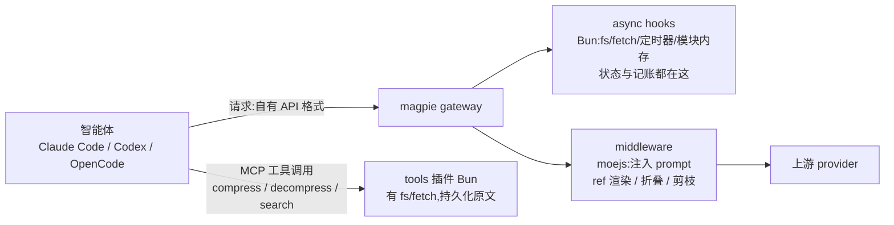

# 能否用 magpie 网关中间件承载 ACP 式上下文压缩

结论先行:**能,但主角不是中间件——是 async hooks 插件。** magpie 的**中间件**接缝(moejs,无 fs/网络/定时器/跨请求内存)只覆盖 ACP 的「请求改写 + 流内改写」;而状态、原文存储、外部摘要这些需要 I/O 的部分,应当放进 **async hooks(Bun)**,和社区里的 `powercontext`、`magpie-openviking` 同一形状。执行压缩工具这一步仍然只能交给客户端(magpie 的 MCP tools 插件)——两个先例都独立写明了「hooks 不能注册工具、一轮只能一次推理」。

依据:本机 magpie `0.1.2819`(`magpie --version`),上游 `yetone/magpie` `main`;`acp-kernel` `0.0.101`。所有结论都指到 src 或第一方文档。

---

## 1. 三档目标,可行/不可行

| 档 | 目标 | 可行性 | 原因 |
|---|---|---|---|
| **T1** | 中间件独立完成:ref 编号与渲染、旧工具输出折叠/剪枝、压缩哲学 system prompt 注入、`📦` 标记与 inbound 清洗 | ✅ 完全可行 | 纯 body→body 变换,`onRequest` 就能做,无状态 |
| **T2** | + 模型驱动的 `compress` / `decompress` / `search_context`:模型写摘要,工具被执行,范围被折叠 | ✅ 可行,但要两件套:tools 插件(Bun)执行 + 中间件按 transcript 折叠 | 中间件不能执行工具,也读不到存储;但「折叠哪个范围」写在 transcript 里,可自证 |
| **T3** | 忠实移植 bili:代理内部就地执行工具、把结果**喂回同一轮**、CCR 原文恢复、tier1→3 蒸馏、`nudge` 用真实 token 数 | ❌ 不可行 | 三处硬约束(§3):无事件注入、无 fetch/fs/timers、无跨请求存储 |

T2 与 bili 的差别只有一处代价:**每次 compress 多一次客户端往返**。bili 在代理内部执行,客户端看不到这一轮;T2 里模型发起的 tool_use 必须发给客户端,由客户端执行 MCP 工具再回传。压缩质量、可逆性、ref 语义都不受影响。

---

## 2. 中间件接缝(已核实)

- 发现方式:`package.json` 的 `magpie.middleware`(别名 `gateway`),或任意 `*.middleware.js|mjs` / `*.gateway.js|mjs` 单文件(`docs/subsystems/gateway-middleware.md:9` Discovery 行 → `internal/plugin/middleware.go`)。"内建 `middleware` 插件关掉就不跑"见同一文档 `:12`。
- 钩子:`onRequest(body, ctx)` → body / `undefined`(保持原字节);`ctx.reject(status, message)` 中断整链并按该协议的形状回错。`onProvider(body, ctx)` 每次换 provider 重跑,`ctx.provider = {id,name,account,model}`。`onAccount(account, ctx)` 返回 `{skip:true}` 跳过账号。`onEvent(event, ctx)` 每个流事件一次:返回对象=替换,`null`=丢弃,`undefined`=原样。`onResponse(body, ctx)` 只针对非流式整体回复(`docs/subsystems/gateway-middleware.md:24-28`)。
- body 与事件的格式是**智能体自己的 API 格式**(`ctx.protocol`: `anthropic|chat|responses|gemini`),不是 provider 的格式;格式转换在中间件之后。这意味着同一份压缩逻辑要写 4 个协议适配,但转换器不用自己写。
- 顺序:`serveAgent` 先建会话身份 + 跑异步 hooks(Bun),再跑 JS 中间件链,再路由(`docs/subsystems/gateway-middleware.md:24`)。中间件只处理**智能体发来的请求**;magpie 自己的请求(标题、意图分类、代搜、代看图)直接走 `serve`,不经中间件(:33)。子搜索/图片描述会把中间件从该请求的 context 上摘掉(`ownAsk`,:33)。
- 运行时:**gateway 进程内的 moejs**(Go 写的 JS 引擎),不是 Bun。模块只编译一次,每个请求从池里取一个 runtime,同请求的钩子共享 `ctx.state`(`internal/middleware/run.go:41`、`docs/subsystems/gateway-middleware.md:31`)。因此 `ctx.state` 是**请求内**的,不是会话内的。
- `ctx` 的实际构造:`Info`(protocol/model/stream/path/agent)+ `options` + `state:{}` + `reject` 函数拼成 JSON(`internal/middleware/run.go:101-110`)。
- 预算:`onRequest`/`onProvider`/`onAccount`/`onResponse` 各 250 ms,`onEvent` **50 ms**,加载 1 s(`internal/middleware/middleware.go:37-39`)。超时/抛错/返回非法值 = 当作没这个钩子,原样放行(fail open,`docs/subsystems/gateway-middleware.md:47`)。
- 沙箱:`import` 只允许插件目录内的相对文件,**没有 node_modules**,依赖必须打进单文件(`docs/subsystems/gateway-middleware.md:48`);runtime 只装了 `console` 一个全局(`internal/middleware/middleware.go:240`),moejs 裸 runtime 无定时器(`MoeForge/moejs` README「Timers and the event loop」)。每行日志走 `console`,每分钟 ≤60 行。
- 本机状态:`magpie plugin builtin` 显示内建 `middleware` 插件 **on**(关掉它,中间件整条链不跑),`tools` 插件也 on。

---

## 3. 三个硬约束(决定了 T3 不可行)

**① 不能注入事件,只能改写/丢弃。** `Run.Wrap` 把 SSE 拆成事件,逐个喂 `onEvent`:对象替换、`null` 丢弃、`undefined` 原样(`docs/subsystems/gateway-middleware.md:28`;`internal/middleware/run.go:411`)。没有「追加一个事件」的钩子。bili 的关键手法——在代理内部执行 `compress` 后**合成 tool_result 塞回同一轮**——在这里没有位置。绕法只有让客户端去执行(§4)。

**② 中间件没有网络、没有文件、没有定时器。** runtime 只装了 `console`(`internal/middleware/middleware.go:240`),moejs 的 `fetch`/`node:fs` 是可选包,magpie 没有给中间件装。后果:
- 外部摘要通道(bili 的 external-summary lane,自己调模型)不可能,**除非**把摘要请求当成一次普通请求发出去——而中间件不能发请求。
- 折叠原文的持久化不可能在中间件侧完成。

**③ 中间件没有跨请求存储。** 只有 `ctx.state`(请求内)和池化 runtime 的模块级变量(哪个 runtime 被复用是随机的,不能当存储)。所以 tier 计数、退避时间戳、token 历史这些都无处安放——**但这条只约束中间件**:hooks(Bun)有 fs、定时器和模块内存,在那里这些都有地方放(§4.1)。

---

## 4. 推荐架构(T2)

三件的分工:

1. **tools 插件(Bun)**:`/mcp/magpie/tools` 暴露 `<plugin>_compress`、`_decompress`、`_search_context`、`_acp_status`。工具由**客户端**声明并执行(magpie 的 tools 插件本来就是这么工作的),55 s 上限,有 `ctx.abort`。持久化折叠原文、BM25/子串检索都在这里,因为只有它有 fs。
2. **middleware(moejs)**:注入压缩哲学 system prompt(按 4 个协议各写一次);每轮给消息贴 `mNNNNN` ref(`ACP TAGS` 塞进消息文本,这是 bili 也用的手法,客户端会原样回传);扫描 transcript 里**已存在的** `compress` 调用 → 把该范围替换成块,并在后续轮次剪掉被折叠的消息与已消费的 compress 调用/结果;`📦 [ACP]` 标记与 inbound 标记清洗。这些都不需要存储:范围写在 tool_use 参数里,摘要写在 tool_result 里。
3. **async hooks(Bun)**:不是「可选记账」,而是**状态的家**(§4.1)。它跑在 Bun 里,有 `fs`、`fetch`、定时器和模块级内存,`ctx.session`/`ctx.cwd`/`ctx.origin` 都在这;限制是不能改 `model`/`stream`/`tools`/`tool_choice`(会被回滚并记为失败,`docs/subsystems/gateway-request-hooks.md`),也拿不到回复流(只有 `onResponse` 通知)。

代价与风险,写清楚:

- compress 变成一次客户端往返:比 bili 多一次模型调用,但仍是模型自己写摘要。
- 折叠状态靠 transcript 自证:客户端若改写历史(compaction、编辑、分叉)会让 ref 漂移。bili 用 ledger 兜底,这里没有 ledger,只能检测到并降级(重新编号 / 重新渲染)。
- 4 个协议各一套消息折叠代码;`chat` 与 `gemini` 的流事件没有名字,`export const events` 只能留空,`onEvent` 拿到全部事件。
- 250 ms 预算:每请求要遍历整个 body 做 ref 渲染。实测 magpie 自己 `onRequest` 改写 80 KB 的 Claude Code body 是 0.2–0.7 ms(`docs/subsystems/gateway-middleware.md` 末尾),几十万 token 的 body 仍在预算内,但不能做全文 BM25——检索放 Bun 侧是对的。

---

## 4.1 社区先例:OpenViking 与 PowerContext 改掉了什么

三个先例都在 2026-10/11 落地,且都有可读源码。最硬的一条:**第三方独立复现了 §3 的结论**——`magpie-openviking` 的 design 文档原文写「The hook contract allows one inference request per client request and offers no way to register a tool」,并把「remember」实现成确定性触发 + 完成回调里的一次普通写,而不是工具调用。

| 借鉴点 | 出处 | 我们用在哪 |
|---|---|---|
| hooks 才是带状态的那一侧:可 `fs`/`fetch`/定时器/模块内存 | `powercontext` 用闲置 10 分钟定时器做捕获;`magpie-openviking` 用本地状态文件 + 独占锁 | 折叠原文存储、tier 计数、nudge 记账、外部摘要通道全部搬到 hooks,中间件只留流内改写 |
| **锚点哈希链**:`sha256(anchor_prev + NUL + item)`,逐条人消息算一个 anchor;record 只对「这个完整前缀」有效,不在当前历史里的 record 直接丢弃 | `magpie-openviking` `lib/protocol.mjs` `ANCHOR_SEED`、`docs/design.md`「Request path」第 4-5 步 | 替代 bili 的 ledger:压缩块跟着 anchor 走,客户端 compaction/分叉后旧 record 自然失效,不会永久耗尽预算 |
| scope 刻意**排除** first-prefix hash,只按 endpoint/credential/agent/cwd/session/protocol | 同上第 3 步(客户端会在请求间重写 system notice) | 会话状态分桶:别用 system prompt 做 key |
| 注入块 **byte-stable replay**;控制指令只加到出站请求,永不进客户端历史 | 同上;`lib/protocol.mjs` `inject`/`appendToLatest` | ref 渲染必须幂等:同一段历史必须产出同一段字节,否则每轮都 miss prompt cache |
| wrapper 标记 + 实体转义,防止被注入文本伪造块边界 | `sanitizeRecall`,`MARKER = '<openviking-context source="magpie-openviking">'` | 我们自己也要把 `$$HASH$$`/`📦 [ACP]` 形状的文本转义掉(等价 bili 的 token 伪造防护) |
| 失败一律 fail open;超时在本轮**冻结**,重试不重写旧前缀 | `docs/design.md` 末段 | 中间件/hooks 超时降级路径 |
| provenance ≠ 幂等:**不确定**的写入永不自动重发,只人工对账 | `docs/design.md`「Capture path」、四态状态机 | 折叠原文与摘要落盘同样按「写入可能已落地」处理 |
| 只允许 host 分类为 `local` 的请求;远端单独 opt-in;凭证扫描命中就整条跳过 | `powercontext` README「Behavior and options」 | 默认不把会话内容送到任何外部服务 |
| 只删「出现了两次」的东西,**正在发送的这一轮永不改写**;并明说改前缀=按未缓存计费 | `middleware-history-trim` README「Prompt cache」 | 我们的 fold/prune 只动「已被摘要覆盖」的部分,当前轮原样 |
| 规则要在 `onProvider` 按**真实尝试的供应商**选(路由组时 `onRequest` 看不到),`ctx.state` 标记避免重复 | `middleware-codex-history` v0.1.2 | 若按 provider 开关,别在 `onRequest` 里判 |
| Responses 的 `previous_response_id`/`conversation`/`item_reference`/加密压缩历史无法安全改写时**明确拒绝**,不静默丢 | 同上「原理与边界」 | Codex 若走服务端历史,我们只能 fail open |
| 宿主常量与预算:| `magpie-openviking`:effort = `min(timeoutMs, gatewayTimeoutMs - 200)`,`gatewayTimeoutMs` 是**每插件**选项(默认 1 s,建议 3 s),派生预算 <500 ms 记 `skipped`;replay 字节夹到 **32768** | 我们的 hooks 超时配置与单次注入上限 |

两个操作层的坑(先例都用血写下来了):

- `package.json` 里的 `magpie.options` **只是 `magpie plugin options` 的打印建议**,宿主不会自己应用;已加载的宿主**不会重读**新保存的 options,必须 `magpie plugin off/on` 或重启。
- 日志/状态别只看插件页计数:它统计的是**每次钩子调用**(含直通),不是生效次数。

状态码契约照抄:`ready` / `empty` / `skipped` / `unbound` / `unavailable` / `unauthorized` / `invalid`,再加 `mismatch`(持有的候选没在客户端历史里出现)。

---

## 5. 复用 acp-kernel 的可行性

`acp-kernel@0.0.101`:**零依赖**,`dist/index.js` 312 KB(wire 入口 64 KB),`DESIGN.md` 明确「core holds no state and performs no I/O;state 是每次调用的输入输出」——正是中间件需要的形状。但直接 import 会崩在三处:

- `dist/index.js:1387` `import { createHash } from "crypto"`(content-store)
- `dist/index.js:1431` `import { join } from "path"`(ccr)
- `dist/index.js:5956-5957` `readFileSync`/`readdirSync`/`path`(packs,读内置 prompt-rule 包)

做法:esbuild 打包进单文件 + 三个 shim(`sha256` 用纯 JS 实现,`path.join` 手写,prompt-rule 包改成编译期内联字符串)。`wire/index.js:2` 也需要 `createHash`。打包后文件会到 ~400 KB,仍在 moejs 可接受范围(moejs 一个 runtime 装大插件约 81 KiB 内存)。

另一个现实问题:kernel 的 `processTurn` 期望完整的 state(blocks、refs ledger、tier 计数)。在中间件里只能每轮从 transcript 重建;**但搬到 hooks(Bun)以后不必**:hooks 有本地文件与模块内存,可以像 `magpie-openviking` 那样把 state 落到磁盘(原子替换 + 独占锁 + dirty flag),再用 anchor 哈希链判断这份 state 是否还属于当前历史。因此推荐**复用 kernel 的纯函数**(`resolveBoundaries`、`assign-refs`、`render-refs`、`prune`、`decideNudge`),state 由 hooks 持有;`createCore(ports)` 的整条管线只看它的 state 形状,不必照抄它的 I/O。

---

## 6. 里程碑

| 阶段 | 交付 | 验收 |
|---|---|---|
| M0 | `hooks.mjs` + `package.json`(`magpie.hooks`):注入压缩 philosophy、按 anchor 哈希链给消息贴 ref、只折叠「已被摘要覆盖」的旧工具输出;不碰当前轮 | 沙箱网关 + 假上游:上游收到的字节里能看到注入块;同一段历史连续两次请求产出**逐字节相同**的 body(幂等,否则每轮 miss prompt cache);`magpie plugin off/on` 后 options 生效 |
| M1 | tools 插件(Bun)提供 `compress`/`decompress`/`search_context` + 本地原文 store(原子替换 + 独占锁 + uncertain 不自动重发);hooks 读 transcript 里已发生的 compress 结算折叠;4 协议适配 | 真实 Claude Code/OpenCode 会话里跑通 compress→折叠→decompress 往返;杀掉 magpie 再起,折叠与原文都还在 |
| M2 | nudge 判定(体积估算 → hooks 落盘的真实记账)、tier 计数与退避、客户端 compaction 后 anchor 失效自动重编号;可选中间件只做流内 `📦 [ACP]` 标记清洗 | 长会话无悬空 ref / tool_use-result 失配;客户端 compaction 后自动重新编号且不重复计费 |

---

## 7. 验证记录与未验证项

- 〔已验证〕单文件中间件能被发现并注册:隔离 `HOME` 下 `magpie plugin add /abs/path/acp.middleware.js` 返回 `✓ added`,写出的 `~/.config/magpie/plugins.json` 为 `{"plugins":[{"spec":"/abs/path/acp.middleware.js"}]}`;同一沙箱里手写的 `providers.json`(自定义 `chat` base URL)也被 `magpie providers` 识别。
- 〔未验证〕沙箱里 `magpie web --gateway --addr 127.0.0.1:3499` 没有输出、也没监听该端口(可能因为本机已有 magpie 实例在跑),所以**钩子被真实请求调用**这一步没在本机跑通。M0 的第一件事就是补上这一条:起一个假上游 + 沙箱网关,断言 `onRequest` 写进 body 的标记出现在上游收到的字节里。
- 〔未验证〕tools 插件的 `ctx` 是否带 `session`/`cwd`(决定原文存储怎么分桶)。文档只写了 `ctx.abort`,没有列出字段。
- 〔未验证〕magpie 内建的 `compacting`/`codex_compact_guard` 与中间件折叠是否会互相打架(`internal/gateway/compacting.go`、`codex_compact_guard.go` 存在,但语义未读)。
- 〔未验证〕moejs 对 `BigInt`/`Proxy` 以外的偏门 API 覆盖(README 声称通过 79,385 条 test262);打包后的 kernel 是否 100% 跑通需实测。
- 〔未验证〕客户端(Claude Code / Codex)对「`onRequest` 注入声明但客户端自己不认识」的工具如何处理——T2 依赖客户端自己连 magpie 的 MCP 端点,而不是靠注入工具声明。

## 8. 引用

- `internal/middleware/middleware.go`(运行时、编译、池、限制)— https://github.com/yetone/magpie/blob/main/internal/middleware/middleware.go
- `internal/middleware/run.go`(`Run`、`ctx` 构造、`onEvent` 应用)— https://github.com/yetone/magpie/blob/main/internal/middleware/run.go
- `docs/subsystems/gateway-middleware.md`(接缝契约、限制、失败行为)— https://github.com/yetone/magpie/blob/main/docs/subsystems/gateway-middleware.md
- `docs/subsystems/gateway-request-hooks.md`(异步 hooks,可回滚字段)— https://github.com/yetone/magpie/blob/main/docs/subsystems/gateway-request-hooks.md
- 插件作者文档(钩子、`ctx`、示例)— https://usemagpie.ai/docs/zh/plugins#middleware
- `acp-kernel@0.0.101`:`DESIGN.md`(纯核心契约)、`dist/index.js`、`dist/wire/index.js`(node 内建依赖)
- 社区先例:`MengXiangxi/magpie-openviking`(v0.2.2,`lib/protocol.mjs` 锚点链、`docs/design.md`)— https://github.com/MengXiangxi/magpie-openviking
- 社区先例:`@magpie-community/gateway-powercontext`(v0.2.1,`powercontext.hooks.mjs`、README「Behavior and options」)— https://github.com/magpie-community/plugins/tree/main/packages/powercontext
- 社区先例:`@magpie-community/middleware-history-trim`(v0.1.0,prompt cache 成本与「当前轮不改写」)— https://github.com/magpie-community/plugins/tree/main/packages/history-trim
- 社区先例:`@magpie-community/middleware-codex-history`(v0.1.2,`onProvider` 选规则、Responses 历史边界)— https://github.com/magpie-community/plugins/tree/main/packages/codex-history
- moejs(引擎能力:裸 runtime 无定时器,`webapi`/`node` 为可选包)— https://github.com/MoeForge/moejs
