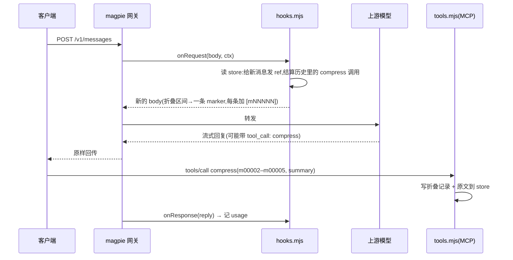

# 完整方案:billion-context 原生方式 → magpie 插件方式

这份文档回答三件事,按顺序读即可:

1. **billion-context 原生是怎么工作的**,以及它在不同 agent 下的接法差异;
2. **magpie 插件版是怎么工作的**,以及它为什么是这些形状;
3. **怎么从 agent 插件迁到 magpie 插件** —— 分阶段、可回滚、带验收信号。

配套文档(细节都在那里,这里只给结论与路径):

| 文档 | 内容 |
|---|---|
| `docs/billion-context-how-it-works.md` | bili 的机制逐行分析(300 行,引用已对齐上游 HEAD `3a2d051`/v0.1.211) |
| `docs/magpie-middleware-feasibility.md` | 为什么不能把 bili 原样搬进 magpie 中间件(三条结构性约束) |
| `docs/magpie-acp-plugin-design.md` | 本插件的设计、里程碑记录 M0–M3、实测数据 |
| `docs/agent-migration-matrix.md` | 六客户端逐项对照矩阵(与本文 §3 互为详略) |
| `docs/bili-parity.md` | 上游变更如何跟踪(`npm run parity`) |

---

## 1. billion-context 的原生工作方式

### 1.1 进程模型:一个 shim + 一个常驻代理

bili 不是"一个代理",是**两段**:

- **客户端内的 shim**:随宿主进程启动,负责把模型 API 流量改道,并附带身份信息;
- **本地常驻代理**:真正做压缩的进程,占一个回环端口,持有 SQLite 账本。

改道有三种形态(任一 agent 都用其中之一):

| 形态 | 做法 | 谁用 |
|---|---|---|
| A `baseURL` 前缀 | 把 base URL 写成 `http://127.0.0.1:<port>/bili/<真实上游URL>`,代理看到 `/bili/` 前缀就剥掉转发 | 手工配置、部分 IDE |
| B 进程内 fetch 补丁 | 替换 `globalThis.fetch`,命中模型 API 后缀才改写 URL(`src/agent/native-intercept.ts:1056 installNativeFetchIntercept`,`:265 MODEL_API_SUFFIX`,`:355 routedBiliModelUrl`) | pi、omp、dsh |
| C 宿主插件缝 | 用宿主自己的扩展/钩子(HTTP client 钩子、MCP、SessionStart hook) | opencode 2.x、codex、claude |

三种形态都要先**确保代理在跑**:`planNativeOmp` / `planNativeDsh` / `planNativeOpencode` 都返回 `{mode: "off" | "attach" | "spawn", attachOrigin?}`,attach 优先,避免重复起进程(`src/agent/omp-native.ts:47`、`src/agent/dsh-native.ts:205`、`src/agent/opencode-native.ts:115`)。

### 1.2 一次请求发生了什么

代理收到请求后,在**转发前**用纯函数内核(`kernel/`)重写 body,管线顺序固定:`assign-refs → sync-blocks → prune → filter → hide-compress-calls → recommend → nudge → emergency-truncate → render-refs`。要点:

- 每条消息按内容哈希得到稳定 `blockId`,显示用的 ref(`m00123`)由会话账本发号;
- 模型自己调用 `compress(startRef, endRef, summary)`,代理**自己执行**这个调用(折叠记账),并把 `tool_result` 塞回流里,客户端因此看起来像普通工具轮;
- 折叠后的摘要在下一次请求里替代被折叠的区间,`decompress` 由代理从 SQLite 取原文;
- 上下文占用接近窗口时注入 nudge,超阈值做分级(tier)蒸馏。

数据落在 `~/.local/share/billion-context/sessions/index.db`:`messages`(31,574 行,其中 1,166 行 `retired_at` 非空)、`content`(原文;默认明文 JSON,`BILI_PERSIST_ZSTD=1` 时才 zstd,`src/persist.ts:73-78`)、`blocks`(437 行,tier/start_ref/end_ref)、`refs`。

### 1.3 不同 agent 下的接法(差异都在"四个职责")

bili 认为每个宿主都要做四件事,只是实现位置不同:

1. **路由**:把流量引到代理;
2. **身份**:告诉代理这是哪个会话/哪个 agent/多长窗口;
3. **压掉宿主自己的压缩**:否则两套压缩打架;
4. **工具**:注册 `compress`/`decompress`/`search_context`,调用仍由代理执行(`POST /__bili/plugin/tool`)。

`src/plugin-install.ts:88`:`PLUGIN_AGENTS = ["pi","omp","claude","codex","opencode","dsh","kimi","hermes","zcode"]`。

| agent | 安装点(`src/plugin-install.ts:6-19`) | 路由缝 | 会话身份 | 宿主自身压缩 | 工具 |
|---|---|---|---|---|---|
| **pi** | `~/.pi/agent/settings.json` 的 `packages[]`(项目级另有 `<project>/.pi/settings.json`) | `globalThis.fetch` 补丁 | 客户端会话 id + `biliMsgIds`/`biliLedgerSeqs`(`src/msgid-pin.ts:13,21`) | 由 bili 接管 | Extension 注册 |
| **omp** | `~/.omp/agent/config.yml` 的 `extensions: [<abs>/dist/agent/omp-native.js]` | 自举代理后打 `fetch` 补丁,设 `BILLION_CONTEXT_PROXY`(`src/agent/omp-native.ts:11-17`) | 同上;omp 无 `before_provider_headers`,runtime-info 改走 `before_provider_request` | 接管 | Extension 注册 |
| **claude** | `claude mcp add`(写 `~/.claude.json`)+ managed settings | `env.ANTHROPIC_BASE_URL` 钉到**稳定端口**(`BILI_CLAUDE_NATIVE_PORT` > config `claude.nativePort` > **48787**,`src/claude-native-bootstrap.ts:6-8,62-63`) | `x-claude-code-session-id` 等头 | 接管 | MCP(stdio)+ SessionStart hook |
| **codex** | `~/.codex/config.toml` 的 `[mcp_servers.bili]` | `[model_providers.*]` 指向代理 | Responses 会话 | bili 会在历史里插自己的压缩项,读回时用 `stripBiliCompactionItems` 清掉(`src/codex-compact.ts:21,156,164`) | MCP |
| **opencode** | `<cfg>/opencode.json{c}` 或 `config.json`: `mcp.bili` + native plugin 目录 + **`compaction.auto=false`**(`:11`) | 2.x 用 `http.request` 钩子(`createNativeRoute`,`src/agent/opencode-native.ts:193`);V1 用插件 | `x-opencode-session` 等头;V2 拿不到宿主 msgId,退化成内容派生 id | 显式关掉(`:71-73` 注释) | MCP |
| **dsh** | 无文件:`dsh plugin --profile <name> add` | cordis plugin 内 `fetch` 补丁(`src/agent/dsh-native.ts:6`) | 头 + 父会话血缘 | 双平面关闭(`:37-43`,配 `dsh-compaction-disable.ts`) | 插件内注册 |

一句话:**pi/omp/dsh 靠打补丁,claude 靠环境变量钉端口,codex 靠配置表,opencode 靠官方插件缝;每个宿主都要额外做"身份 + 压掉宿主压缩 + 注册工具"**。

---

## 2. magpie 插件版的工作方式

### 2.1 进程模型:零端口、三件套

magpie 网关本身就站在客户端与上游之间(`127.0.0.1:3425`),所以**不需要 shim,也不需要额外端口**。本插件是三个入口:

| 入口 | 运行环境 | 职责 |
|---|---|---|
| `hooks.mjs` | magpie 进程内的 Bun(异步请求钩子) | 每个请求一次:打 ref、结算 `compress`、折叠历史、注入提示与 nudge;`onResponse` 记真实用量 |
| `tools.mjs` | 同上,经 magpie 的 MCP server `/mcp/magpie/tools` | `compress`/`decompress`/`search_context`/`acp_status`,**由客户端调用**,不是网关自己执行 |
| `cli.mjs` | 操作员终端(Node) | `status/sessions/block/forget/unlock/reconcile/evict` |

与 bili 的四职责对照:

| 职责 | bili | 本插件 |
|---|---|---|
| 路由 | shim 改 baseURL / 打补丁 | **不需要**:magpie 已经在链路上 |
| 身份 | 自造 `x-bili-plugin`、`x-bili-plugin-conversation`、`x-bili-plugin-model`、`x-bili-plugin-turn` 等头 | 用 magpie 已有的 `ctx.session`(取 `X-Magpie-Session` 或宿主自带头,`internal/gateway/gateway.go:8595-8630`)、`ctx.agent`、`ctx.protocol` |
| 压掉宿主压缩 | 每个宿主分别关 | **不关**:magpie 只呈现 codex 的窗口设置,不擅自改(`internal/agent/codex_compact_held.go:3-12`) |
| 工具 | 代理自己执行 | **客户端执行**(magpie 的 MCP tools server),因为钩子没有网络/文件/定时器 |

### 2.2 一次请求的数据流



关键差异:**折叠发生在"下一个请求进入时"**,由钩子按内容哈希重算,而不是靠代理维护的会话状态。这样断电/重装/换插件都不会把历史写坏,只是丢压缩收益。

### 2.3 能力映射

| bili 有 | 本插件 | 说明 |
|---|---|---|
| 消息 ref | ✅ | 只发可见消息,`system`/`developer` 不发(因此结构上不可被折叠) |
| `compress` 折叠 + 摘要进历史 | ✅ | 模型在正常工具轮里写摘要,网关不调模型 |
| `decompress` 取回原文 | ✅ | 内容寻址 `<store>/blocks/<blockId>.json` |
| `search_context` | ⚠️ 降级 | 子串 + 词频排序,不是 BM25 |
| nudge / emergency | ✅ 阈值版 | 窗口是**声明值**(钩子拿不到模型窗口),用量取 `usage`(真实计费) |
| 分级蒸馏(tier2/tier3) | ❌ | 需要代理侧重写历史,钩子做不到 |
| CCR 阈值截断、`acp-cache` | ❌ | 同上 |
| 折叠后 `tool_result` 注入 | ❌ | 钩子不能往流里插事件 |
| 会话账本 | ⚠️ 内容寻址账本 | ref 号单调,但按 blockId 记账;客户端压缩后锚点消失即自动放弃该折叠 |

---

## 3. 迁移方案

### 3.1 要先想清楚"搬什么"

| 要搬的东西 | 是否需要搬 | 依据 |
|---|---|---|
| **流量**(base URL / 插件缝) | 要 | 让客户端指向 magpie,或让 magpie 面板"连接"该客户端 |
| **历史** | **不用** | 客户端窗口里存的是它自己的完整历史;bili 的折叠只在链路侧发生。实测:omp 45 条用户消息 33 条在客户端逐字存在,缺的 12 条都是 bili 合成的 wire 消息 |
| **数据**(折叠原文) | 建议搬 | 否则旧 ref 无法 `decompress`;用 `scripts/import-bili.mjs` 导入 |

### 3.2 阶段(顺序不能颠倒)

| 阶段 | 做什么 | 影响面 | 验收信号 | 回滚 |
|---|---|---|---|---|
| **0 影子** | 装 magpie(已有则跳过)、`magpie plugin add ./`;插件保持默认 `enabled:false` | 零 | `magpie plugin --json` 里能看到本插件的 hooks,`calls` 为 0 | 删插件 |
| **1 数据** | `node scripts/import-bili.mjs --all`(或先 `--namespace omp --limit 5`) | 只写 `~/.local/share/magpie-acp` | `node cli.mjs status` 有块数;`decompress m00021` 返回原文 | 删 store 目录 |
| **2 单客户端灰度** | `magpie plugin options magpie-acp-context '{"enabled":true,"agents":["omp"]}'`;在该客户端按"连接" | 只有 omp | 该客户端请求里出现 `[mNNNNN]`;其他客户端字节不变 | 删 `agents` 或 `enabled:false`(下个请求生效) |
| **3 逐个加** | 每加一个客户端观察 2–3 天 | 该客户端 | `acp_status` 的折叠数上升、`evicted=0`、客户端自身压缩未触发 | 同上 |
| **4 退役 bili** | 只对已验收的客户端卸 bili 插件;最后才删 `~/.local/share/billion-context` | 已验收客户端 | 一周内无回退需求 | 按 bili 的 `.bili-bak` 恢复配置 |

**唯一能打断"正在进行的其他窗口"的动作**:在 magpie 面板对 bili 当前占着的客户端按"连接"。客户端配置只在这个动作里被写(`internal/gui/api.go:1272-1290` 的 `POST /api/agents/{action}/{id}`,动作 `connect`/`disconnect`/`reapply`/`keep`)。启动、装插件、重启网关都不自动接管。

### 3.3 逐客户端动作表

| agent | 切换到 magpie 的动作 | 之后要额外做的一步 | 会降级的地方 |
|---|---|---|---|
| **omp** | 面板"连接"(写 `config.yml` 的 `providers.magpie`,见 `internal/agent/omp.go:245`) | Library 里给 omp 打开本插件的 4 个工具 | 无 |
| **pi** | 面板"连接" | 同上 | 无 |
| **claude** | 面板"连接"(写 managed settings 的 `env.ANTHROPIC_BASE_URL`,见 `internal/agent/claude.go:27-35`) | 同上;**先把 48787 让出来**(bili 卸载后端口才释放) | 无 |
| **codex** | 面板"连接"(写 `[model_providers.magpie]`,`internal/agent/codex.go:47`) | 同上;如需长会话,自己设 `model_auto_compact_token_limit`(magpie 不替你改) | 宿主自动压缩仍可能触发 |
| **opencode** | 面板"连接" | 同上;**把 `compaction.auto` 从 `false` 改回 `true`** 或保持关闭(二选一,见下) | 若保持关闭,长会话要靠本插件折叠 |
| **dsh** | 面板"连接"(写 route 文件,`internal/agent/dsh.go:907-975`) | 同上;bili 的 compaction 禁用条目要一并移除 | 宿主压缩行为回到默认 |

opencode 的选择题:关闭 `compaction.auto`(bili 的做法)意味着宿主不会自己压缩,一切靠本插件;打开意味着两套机制并存,本插件负责"提前折叠",宿主负责"兜底"。**建议迁移期打开**,稳定后再决定。

### 3.4 数据迁移的语义

```sh
node scripts/import-bili.mjs --all                    # 全部会话(374 个)
node scripts/import-bili.mjs --namespace omp --limit 5
node scripts/import-bili.mjs --session <id> --dry-run --json
```

- 只读打开 bili 的 SQLite(`readOnly: true`),不写、不锁、不移动;
- 每个会话一个账本文件,块按 `sha256(role + "\0" + text)[0:16]` 内容寻址,ref 号保持 bili 的原号(`m%05d`);
- 折叠记录从 `blocks` 重建(注意该版本 `start_seq`/`end_seq` 恒为 0,真范围在 `start_ref`/`end_ref`);
- 幂等:同一条消息重复导入得到同一个 blockId;
- 局限:只导 `kind` 为文本类且原文可读的消息;`reasoning` 空文本跳过;无增量游标(`--all` 是覆盖写)。

导入之后,**旧窗口里出现过的 `compress` 调用仍然无法结算** —— 那些 ref 是 bili 发的,我们按内容哈希重算,可能对不上。插件对这种情况会明确说出来而不是静默跳过:

> 历史里有 N 个 compress 调用引用了本插件没有发过的 ref(m00182–m00190),无法按内容结算,已跳过;请用上面给出的范围重新调用。

### 3.5 验收清单(每条都可执行)

```sh
# 1. 插件被加载
magpie plugin --json | grep -A3 magpie-acp-context

# 2. 单测(纯函数层,不碰主机)
bun test test/

# 3. 容器端到端(真实网关 + 真实 MCP + 假上游)
./test/e2e/run.sh

# 4. 真实模型冒烟(必须跑在容器里,需要能出网 + 一个真 key)
docker run --rm -e PROVIDER=deepseek -e PROVIDER_KEY="$DEEPSEEK_API_KEY" \
  -e MODEL=deepseek/deepseek-chat \
  -v "$(command -v magpie-cli-linux-arm64):/b/magpie-cli:ro" -v "$(command -v bun):/z/bun:ro" \
  -v "$PWD/test/live:/work:ro" ubuntu:22.04 \
  bash -c 'cp /b/magpie-cli /tmp/m; chmod 755 /tmp/m; bash /work/live-smoke.sh'

# 5. 灰度客户端跑一轮后
node cli.mjs status --json | jq '.sessions[0]'
```

判定标准:第 2 层 72 pass;第 3 层看到折叠标记、`system` 未被改写、四个工具、重启后仍可 `decompress`;第 5 层 `evicted=0` 且折叠数 > 0。

### 3.6 回滚

| 想撤销 | 动作 | 生效时间 |
|---|---|---|
| 只停压缩 | `magpie plugin options magpie-acp-context '{"enabled":false}'` | 下一个请求 |
| 整体关掉(保留安装) | `magpie plugin off magpie-acp-context` | 重启网关 |
| 停某个客户端 | 从 `agents` 里删掉它 | 下一个请求 |
| 完全卸载 | `magpie plugin rm magpie-acp-context`(或删 `plugins.json` 条目) | 重启网关 |
| 回 bili | 面板对客户端"断开"→ bili 插件仍装着则点其"连接" | 立即 |
| 清空本插件数据 | `rm -rf ~/.local/share/magpie-acp` | 立即 |

本插件不写任何客户端配置文件,所以"回滚"没有配置残留。

### 3.7 风险与不可逆点

| 风险 | 影响 | 缓解 |
|---|---|---|
| 按了"连接"后 bili 不再管该客户端 | 该客户端失去 bili 的折叠与 nudge | 只对空闲窗口执行;随时可断回 |
| 两套压缩并存(opencode/codex) | 折叠收益被宿主压缩覆盖 | 迁移期接受;稳定后关宿主压缩 |
| 无会话头的客户端 | 同目录会话共用账本(块按内容寻址,故不会串内容,只是账本混) | 用带 `X-Magpie-Session` 的客户端,或每目录单窗口 |
| 增长门槛低于实际节奏 | nudge 过早 | 按需调 `nudge.growthFloor`(默认 50000,与 bili 一致) |
| 上游改契约(kernel 默认值/提示词/工具 schema) | 插件不崩,但可能落后 | `npm run parity` 每次升级后跑一遍 |

**不可逆的只有一件事**:删 `~/.local/share/billion-context`。在此之前确认:所有需要旧 ref 解压的会话都已 `import-bili` 导入,且 `decompress` 抽查通过。

---

## 附录

环境变量(本插件):`MAGPIE_ACP_ENABLED`、`MAGPIE_ACP_AGENTS`、`MAGPIE_ACP_MODE`、`MAGPIE_ACP_STORE`、`MAGPIE_ACP_WINDOW`、`MAGPIE_ACP_MIN_PCT`、`MAGPIE_ACP_EMERGENCY_PCT`、`MAGPIE_ACP_MIN_BYTES`、`MAGPIE_ACP_KEEP_TURNS`。

store 布局:

```
~/.local/share/magpie-acp/
  sessions/<sessionKey>.json     {v,next,seq,refs:{blockId:ref},folds:[…],usage:[…],nudge,request}
  sessions/<sessionKey>.lock     钩子只等 120 ms
  blocks/<blockId>.json          {role,text,ref,session,at,source}
```

故障排查:

| 现象 | 先看 |
|---|---|
| 请求没有 `[mNNNNN]` | `enabled` 是否为 true;`agents` 是否包含该客户端名(`acp_status` 的会话列表能看到是哪个 agent) |
| 工具不出现 | Library 里是否给该 agent 打开了本插件的 server;`plugin-tools.json` 是否有记录 |
| `decompress` 说块已失效 | `cli.mjs status` 看 `evicted`;`reconcile --apply` 修 |
| 升级 magpie 后钩子不再跑 | `magpie plugin --json` 看 `loaded` 是否为 null(常见原因:插件缺 `main`/`exports` 或 Bun 未就绪) |
